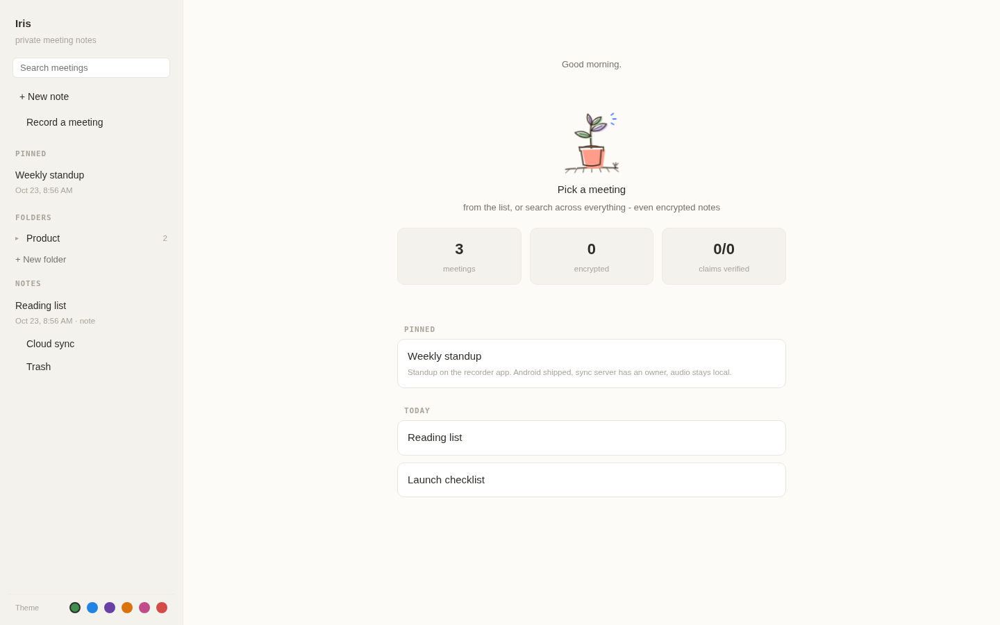
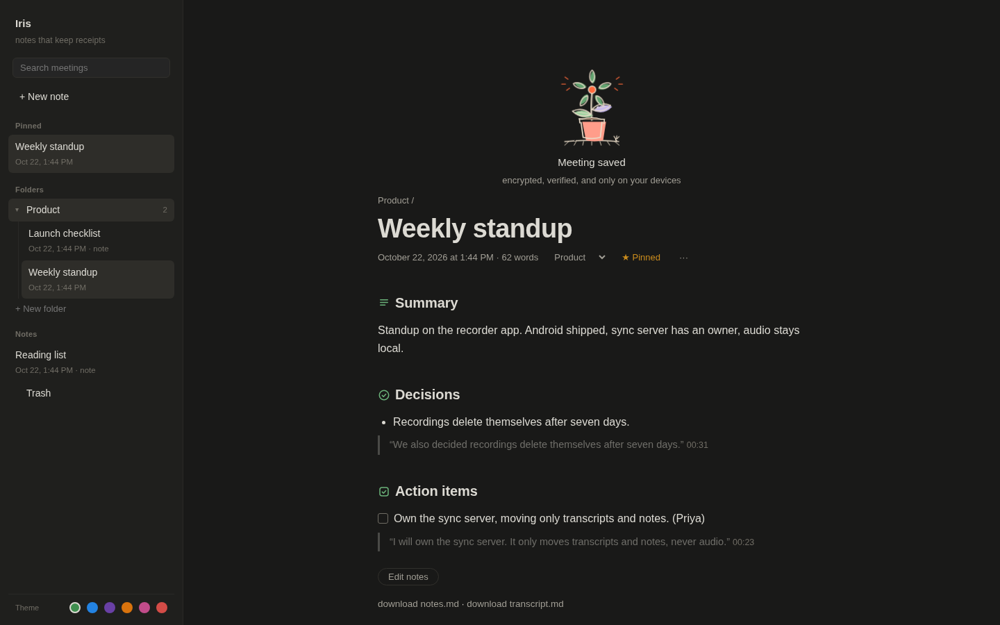
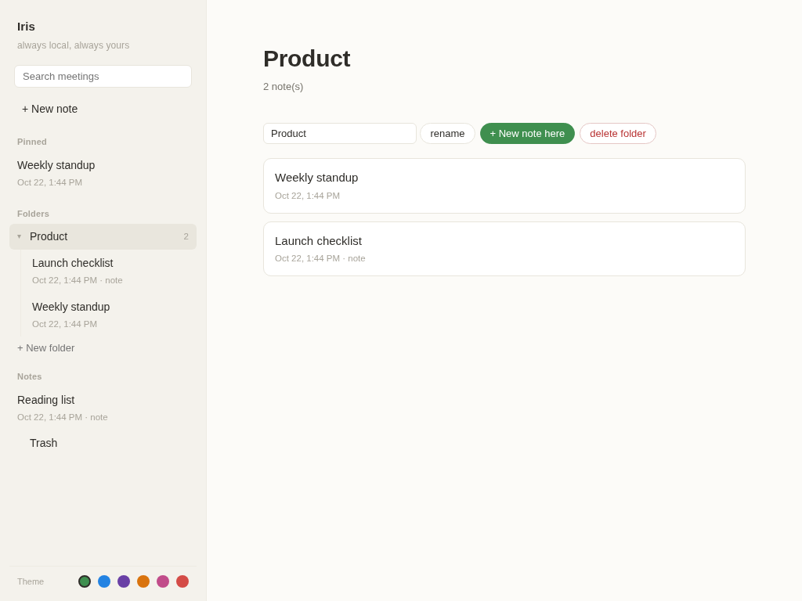
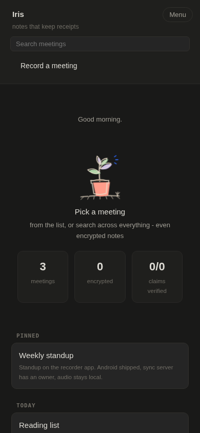

# Iris


Private, local-first meeting notes. Records when you tell it to, transcribes on your
own machine, writes notes you can trust, deletes the audio after a week.

- **Local transcription** - whisper.cpp (tiny/base/small, English + Hindi tested)
- **Notes with receipts** - every decision and action item quotes the exact transcript
  lines it came from, with a timestamp. A verifier checks each claim; anything the
  model invented (a task, a name, a quote) is demoted to "unverified" instead of
  landing silently in your to-do list.
- **Recording retention** - audio auto-deletes after 7 days; transcripts and notes stay.
- **Local-first notes** - default backend is Ollama (gemma3:4b) on your machine;
  a hosted fallback exists for machines too small to run a model.
- **Sync without audio** - a tiny self-hostable server moves transcripts/notes/meta
  between your devices. Recordings never leave the device they were made on.

Android reads Iris Cloud notes too: in the app set the relay URL to `https://iris-cloud-one.vercel.app/sync` and paste a sync token from the site's Account page. (Pull works through the existing relay client; not yet tried on a real phone.)

## How it fits together

```
  phone (Android)                laptop (this repo)                 other devices
 --------------                 -----------------                 ---------------
  record wav ----LAN POST /ingest--> record -> transcribe (whisper.cpp, local)
       |                                  -> diarize (pyannote seg + ERes2Net)
       |                                  -> notes (ollama, or hosted fallback)
       |                                  -> age-encrypt at rest
       |                                        |
       +------- pull transcript/notes ----------+
       |        (never the audio)               v
       +-------------------------------> self-hosted sync relay (stdlib http)
                                                |
                    web UI / search / export <--+
```

Audio never leaves your devices. The relay moves notes (and transcripts if you choose).
If you run `iris encrypt`, they travel as ciphertext and the keys never touch the relay;
without it they are plain text, so use a relay you trust (Iris Cloud sends notes only, over https).

## See it

<p>


</p>
<p>


</p>

Dark mode follows your system; six accent themes live in the sidebar footer.

Regenerate the screenshots with `python3 scripts/demo_shots.py out/` (needs playwright and Chrome).

## Run it

```sh
# build whisper.cpp
git clone --depth 1 https://github.com/ggml-org/whisper.cpp vendor/whisper.cpp
cd vendor/whisper.cpp && cmake -B build && cmake --build build -j --config Release && cd ../..

# models (English)
curl -L -o models/ggml-base.en.bin https://huggingface.co/ggerganov/whisper.cpp/resolve/main/ggml-base.en.bin
curl -L -o models/ggml-silero-v6.2.0.bin https://huggingface.co/ggml-org/whisper-vad/resolve/main/ggml-silero-v6.2.0.bin
# Hindi / multilingual: ggml-small.bin from the same repo (see TESTED.md for why not base)

# notes backend (default, local): ollama pull gemma3:4b
python3 iris/cli.py ingest meeting.wav                      # local notes
python3 iris/cli.py ingest meeting.wav --backend ultramarine  # hosted fallback
python3 iris/cli.py sweep                                   # delete >7-day recordings
python3 iris/cli.py sweep --dry-run                         # preview what would be deleted
python3 iris/cli.py list
python3 iris/cli.py sync --server http://YOUR-SERVER:8471   # sync notes between devices
python3 iris/cli.py sync --server https://iris-cloud-one.vercel.app/sync --notes-only   # Iris Cloud: notes only, no transcript, never audio (token from the site's Account page)

# sync server (self-host, stdlib only)
python3 iris/sync_server.py --dir syncdata --token S3CRET --port 8471
```

## Layout

- `iris/transcribe.py` - whisper.cpp wrapper (VAD sentence segmentation)
- `iris/backends.py` - notes backends (ollama default, hosted fallback)
- `iris/verify.py` - integrity pass (evidence quotes + timestamps + owner names)
- `iris/store.py` - local meeting store + 7-day recording retention
- `iris/sync.py` / `iris/sync_server.py` - device sync (never audio)
- `iris/record.py` - laptop mic capture
- `tests/` - `python3 tests/test_engine.py`
- `TESTED.md` - what is actually tested vs untested, honestly

License: MIT.


## Components

| piece | file | what it does |
|---|---|---|
| CLI | `iris/cli.py` | ingest / sweep / list / sync / key / encrypt / read / export / share / search / ask / enroll / voices / doctor |
| transcription | `iris/transcribe.py` | whisper.cpp + silero VAD, sentence timestamps |
| notes backends | `iris/backends.py` | Ollama gemma3:4b (local default) or Ultramarine (hosted fallback) |
| claim verifier | `iris/verify.py` | every decision/action item must quote the transcript; invented claims demoted |
| retention | `iris/store.py` | recordings auto-delete after 7 days; transcripts/notes stay |
| encryption | `iris/crypto.py` | age X25519 at rest; key at ~/.iris/key.txt (600) |
| sync | `iris/sync.py` + `sync_server.py` | tiny self-hostable relay; moves ciphertext, NEVER audio |
| LAN ingest | `iris/ingest_server.py` | phone posts recordings to your own laptop for transcription |
| speaker labels | `iris/diarize.py` | sherpa-onnx: pyannote-seg + ERes2Net, `ingest --diarize` |
| meeting detect | `iris/detect.py` | laptop: Zoom/Meet/Teams/Webex via process+window+mic signals, debounced |
| local web UI | `iris/webui.py` | Notion x Granola style notes at 127.0.0.1:8473 (localhost only): editor, pins, folders, drag reorder, ask, click-to-name speakers |
| library | `iris/library.py` | pins, project folders, blank notes, free editing, speaker rename, manual order (all synced, encryption-safe) |
| ask | `iris/ask.py` | questions across meetings answered only with quoted transcript lines + time |
| Hinglish | `iris/lang.py` | text-only Hinglish detection (Roman Hindi, Devanagari + English); tagged in transcripts |
| plants | `iris/mascot.py` | hand-drawn plants for empty states and the meeting-saved bloom |
| Android app | `android/` | recorder, meeting nudges, relay sync, on-device age decryption |

## Quick start

```
python3 iris/cli.py key init                 # one-time: encryption key
python3 iris/cli.py key info                 # where the key lives, when it was created
python3 iris/cli.py key qr                   # ASCII QR of the secret key, for phone pairing
python3 iris/cli.py ingest meeting.wav       # record/transcribe/verify/encrypt
python3 iris/cli.py ingest meeting.wav --diarize --speakers 2  # + speaker labels (needs models/get-diarize-models.sh first)
#   pass --speakers N when you know the headcount - auto mode may over-split (tested)
python3 iris/webui.py                        # browse at 127.0.0.1:8473
python3 iris/sync_server.py --token T &      # relay (your own box)
python3 iris/cli.py sync --server http://... # move notes between devices
python3 iris/watch.py                        # nudge when Zoom/Meet/Teams opens (detection only)
python3 iris/cli.py search "retention"       # full-text over all meetings (decrypts locally)
python3 iris/cli.py ask "what did we decide about retention"   # quotes the exact transcript line + meeting + time; silent if nothing matches
python3 iris/cli.py export <id> out.md       # shareable markdown bundle
python3 iris/cli.py share <id> age1... out.md.age  # encrypted for one recipient
```

## Organize from the terminal

```
iris note "Title"            # blank note
iris folder new "Work"       # new folder
iris folders                 # list folders
iris move <note> <folder>    # file a note
iris pin <note> / iris unpin <note>
iris ask "what did we decide about pricing?"
```

Same library as the web UI, so changes show up in both.

## Voice enrollment (who said what, by name)

```
python3 iris/cli.py enroll Priya priya-10s-sample.wav   # teach Iris a voice (local embedding, no audio stored)
python3 iris/cli.py voices                              # list enrolled voices
python3 iris/cli.py ingest meeting.wav --diarize        # known voices appear as "Priya:", unknown as "Speaker 2:"
```

## Phone -> laptop -> everywhere (the cross-device loop)

1. Phone (android/): record in the app (or get nudged when Zoom/Meet/Teams opens).
2. Tap "Send to laptop": the WAV goes over your LAN to `iris/ingest_server.py` on your own machine - never a third party.
3. Laptop transcribes, verifies, encrypts, and pushes ciphertext to your relay.
4. Phone and other devices pull from the relay and decrypt with your key.

## Build the Android app

```
cd android
gradle assembleDebug   # JDK 11+, Android SDK 33; APK at app/build/outputs/apk/debug/
```

