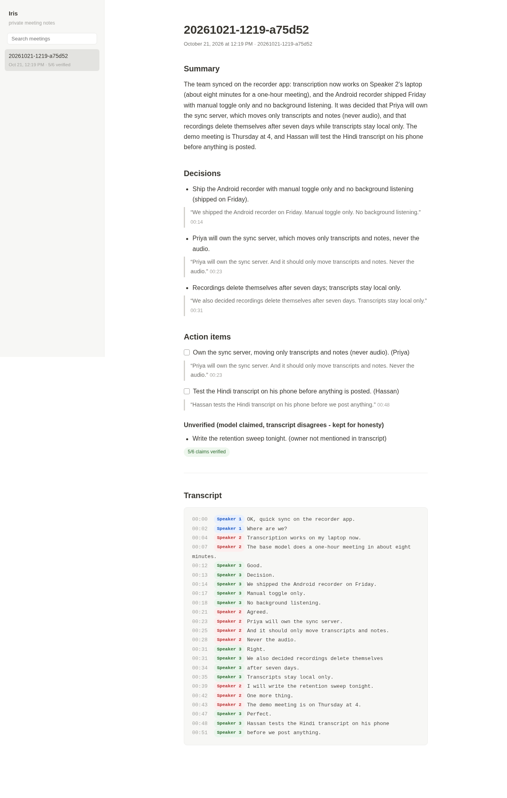
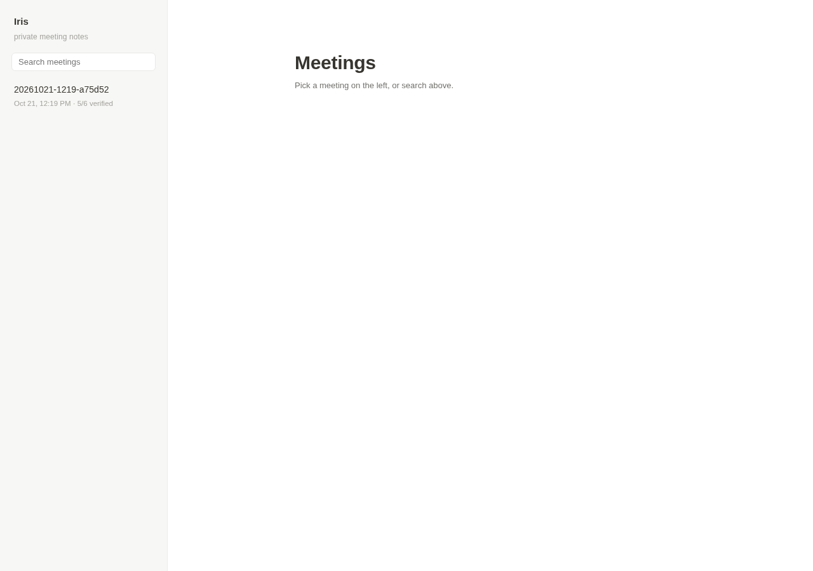

# Iris: I take 6 meetings a day across 3 devices, so I built a notetaker that can't leak them

*(DEV submission draft - UNPUBLISHED. Fill remaining [SLOT]s before Hassan reviews.)*

## What I Built

Iris is a local-first meeting notetaker for people whose meetings don't happen in one place. Phone call on the way in, a Google Meet at the desk, an in-person chat in the hallway - it records (when you tell it to), transcribes on your own machine with open-weight Whisper, and writes the notes with a local open-weight model. Recordings delete themselves after 7 days; transcripts and notes stay on your devices, encrypted, syncing only between hardware you own.

The full loop that shipped:

- **Laptop**: a watch daemon notices when Zoom/Meet/Teams/Webex opens (process + window-title + mic-in-use signals) and nudges you - detection only, recording always starts with your tap. An optional CLI recorder captures the mic. After the meeting, `iris ingest` runs Whisper (silero VAD, sentence timestamps) and the notes model, then encrypts everything with age (X25519) before it touches disk.
- **Phone (Android app, zero third-party deps)**: a foreground-service WAV recorder with an always-visible notification, meeting nudges via the only signal Android allows (foreground-app detection with Usage Access - the OS hides other apps' mics and audio, since Play policy May 2022), and one tap to send the recording over your LAN to your own laptop for transcription. Notes sync back and decrypt on the phone with your age key.
- **Sync**: a tiny self-hostable relay (~100 lines, stdlib Python) moves only transcripts and notes between your devices - NEVER audio - and only as age ciphertext. The relay operator (also you) can't read a word.
- **Reading**: `iris search` across every meeting (decrypts locally), a one-file markdown export, and encrypted sharing - sending notes to a colleague means re-encrypting them to THEIR age key, not uploading anything anywhere.
- **Local web UI** at 127.0.0.1 only, styled like a Notion page: editable titles, an autosaving markdown editor with a `/` block menu and Ctrl/Cmd+B/I shortcuts, project folders, pins, drag to reorder, Trash with restore, a Ctrl/Cmd+K switcher, and an `iris ask` box that answers questions across your meetings with receipts. Dark mode follows your system, accent themes, full-text search. The mascot is a hand-drawn plant that sprouts, sleeps as a seedling at night and blooms when you save your first meeting.
- **Speaker labels**: `ingest --diarize` labels each transcript line Speaker 1 / Speaker 2 / ... using local pyannote segmentation + ERes2Net speaker embeddings (sherpa-onnx). No cloud, no account. And `iris enroll Priya sample.wav` turns "Speaker 2" into "Priya" - voiceprints are 192-d embeddings stored locally, no audio kept.
- **Hinglish, actually**: `--multilingual` detects the language per segment, so a meeting that switches between English and Hindi mid-sentence gets both scripts right in one transcript. (Tested: the English-only model silently DROPS the Hindi turns.)

The part that makes it trustworthy: every decision and action item in the notes must quote the exact transcript lines it came from, with a timestamp. A small verifier checks every claim against the transcript before the note is saved. If the model invents a task or a name, the claim is demoted to an "unverified" section instead of silently becoming your to-do list.

## Demo

### 1. Ingest a meeting (54 seconds of audio, base model, CPU only)

```text
$ python3 iris/cli.py ingest standup.wav --diarize
meeting: 20261021-1219-a75d52
backend: ultramarine (hosted fallback - dev sandbox has no GPU; on a laptop this is ollama/gemma3:4b, local)
integrity: {'checked': 6, 'passed': 5}
```

transcript.md (sentence-level, VAD segmentation, speaker labels from `--diarize`):
```text
[00:14] Speaker 3: We shipped the Android recorder on Friday.
[00:23] Speaker 2: Priya will own the sync server. And it should only move transcripts and notes. Never the audio.
[00:31] Speaker 3: We also decided recordings delete themselves after seven days. Transcripts stay local only.
[00:39] Speaker 2: I will write the retention sweep tonight.
[00:48] Speaker 3: Hassan tests the Hindi transcript on his phone before we post anything.
```

notes.md (every claim carries its receipt):
```text
## Decisions
- Recordings delete themselves after seven days, and transcripts stay local only.
  > "We also decided recordings delete themselves after seven days. Transcripts stay local only." [00:31]

## Action items
- [ ] Own the sync server, moving only transcripts and notes (never audio). (Priya)
  > "Priya will own the sync server. And it should only move transcripts and notes. Never the audio." [00:23]

### Unverified (model claimed, transcript disagrees - kept for honesty)
- Write the retention sweep tonight. (owner not mentioned in transcript)

_integrity: 5/6 claims verified against transcript_
```

That last block is not staged: the transcript really does say "I will write the retention sweep tonight" with no name, the model guessed an owner, and the verifier refused to put the task in anyone's to-do list. Same meeting, same run.

### 2. The verifier catching the model inventing a person (live, unscripted)

I told the notes model to always assign an owner, inventing one if unclear - the thing every notes AI does quietly. Two runs, two invented people ("Sam", then "Alex") - each attached to a quote that really is in the transcript, so quote-checking alone passed them. The verifier now checks owners too:

```text
integrity: {'checked': 5, 'passed': 4}
DEMOTED: Alex -> owner not mentioned in transcript
```

The invented task does not make it into your to-do list. It lands in an "unverified" section, with the reason.

### 3. Retention sweep

```text
$ python3 iris/cli.py sweep
deleted store/old-meeting/audio.wav     # 8 days old
# transcript.md and notes.md for the same meeting: untouched (verified after the run)
```





## Code

[REPO LINK - private until Hassan approves]

## Why open innovation matters for this build

Meetings are the most private audio most people produce: client names, salaries, health, unreleased plans. The dominant notetakers (Otter, Fireflies) work by uploading that audio to someone else's cloud. Iris exists because the models are open: Whisper's weights are MIT, Gemma's are open, so the whole pipeline - record, transcribe, summarize - runs where the audio already is. No vendor to trust, no per-minute bill, works on a plane. [Also honest: iOS 18 call recording, Pixel Recorder and Galaxy AI each do pieces of this, but only inside their own silo - open models are what let one archive span an Android phone, a Linux laptop and everything between.]

## The honest limits (tested vs untested)

Speaker labels took three tries, and the first two failures are in the repo history. whisper.cpp's tinydiarize detected ZERO speaker turns - not on synthetic two-voice audio, not even on 16 alternating turns of real human speech from LibriSpeech. The first working stack also failed silently: one embedding model (campplus) cheerfully attributed every line to a single speaker. The third - pyannote segmentation + ERes2Net embeddings via sherpa-onnx - attributes every turn correctly on both test sets, so THAT is what shipped. If I had only run it on one file and eyeballed the output, I'd have shipped the broken one. Languages: Hindi is strong on ggml-small (correct script, code-mixed words fine), Spanish perfect, Tamil good - but Bengali comes out in the WRONG SCRIPT (Devanagari), so it's documented as unsupported. (Synthetic TTS + LibriSpeech tests - real meeting audio is noisier; full matrix in TESTED.md.)


Read the demo transcript above again: the speaker said "we ship on Friday" and Whisper heard "we shipped". The verifier passed that line - correctly, because the quote really is in the transcript - but the transcript itself misheard. That is the honest limit of this design: the integrity pass stops the MODEL from inventing things; it cannot stop the EARS from mishearing. Also real: Hindi needs the small multilingual model (base translates instead of transcribing - tested), mixed Hindi-English audio needs per-segment language detection, and speaker labels degrade when two voices sound alike (tested on similar-pitch synthetic voices - misattributed short turns). Full list in TESTED.md in the repo.

## Prize Categories

- Best Use of Gemma - notes written by gemma3:4b running locally via Ollama
- Best Use of Ultramarine - hosted fallback notes backend; usage is logged locally per run (`~/.iris/hosted-usage.jsonl`) so the spend claim is real, not estimated [CONFIRM DASHBOARD TOTAL BEFORE PUBLISH]
- Best Use of Temporal - [if it lands: durable ingest pipeline]
- Best Use of MongoDB Atlas - [if it lands: sync store]
- Best Use of a .tech Domain - [demo page if deployed]

*Built with: whisper.cpp (MIT), Whisper tiny/base/small (MIT), pyannote segmentation + ERes2Net via sherpa-onnx, Gemma 3 via Ollama, age (X25519), Kotlin/Android (zero third-party deps), Python stdlib. Tests: 98 Python unit/integration tests + 10 Android JVM unit tests, both green on CI. License: MIT.*
